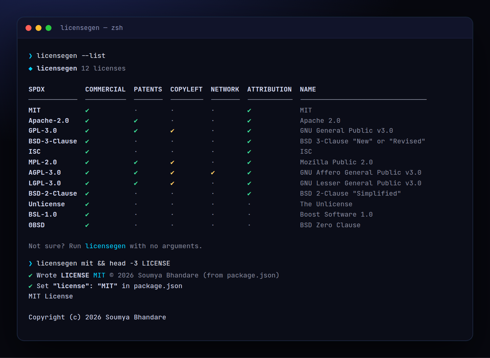

<!-- ═════════════ HEADER ═════════════ -->
<p align="center">
  
</p>

<p align="center">
  
</p>

<p align="center">
  <a href="https://github.com/krishyaa06/prism-license-gen/actions/workflows/ci.yml"></a>
  
  
  <a href="LICENSE"></a>
</p>

<p align="center">
  
</p>


## ⚡ Overview

**Prism License Gen** (`licensegen`) adds a proper `LICENSE` file to any project. It ships the 12 most-used open-source licenses using the official texts from GitHub's licenses API (the same ones choosealicense.com uses), fills in the year and your name from `package.json` or `git config`, and updates the `license` field in `package.json`. Not sure which one to pick? Run it with no arguments and answer three yes/no questions.

## ✨ Features

- **12 licenses**: MIT, Apache-2.0, GPL-3.0, AGPL-3.0, LGPL-3.0, MPL-2.0, BSD-2/3-Clause, ISC, Unlicense, BSL-1.0, 0BSD
- Author auto-detected from `package.json` → `git config user.name`; override with `-n`
- `--list` comparison table: commercial use, patents, copyleft, network clause, attribution
- Interactive picker: 3 yes/no questions → a recommendation with a one-line explanation
- `--info <id>` permissions / conditions / limitations; `--check` detects an existing LICENSE
- Sets `"license"` in package.json, refuses to overwrite without `--force`. Works offline, zero deps

## 🚀 Quick Start

```bash
# run without installing
npx github:krishyaa06/prism-license-gen mit

# or install globally
npm install -g github:krishyaa06/prism-license-gen
licensegen --list
```

Requires Node.js 18.17+. No dependencies.

## 🛠️ Usage

```text
licensegen mit                  write LICENSE (author from package.json / git)
licensegen apache -n "Soumya"   set the copyright holder
licensegen                      interactive: answer 3 questions, get a pick
licensegen --list               all licenses, compared
licensegen --info gpl           permissions / conditions / limitations
licensegen --check              detect the LICENSE already in this folder

  -n, --name <name>     copyright holder
  -y, --year <year>     copyright year (default: this year)
  -o, --out <file>      output file (default: LICENSE, "-" for stdout)
      --force           overwrite an existing LICENSE
      --no-pkg          don't update "license" in package.json
```

Aliases work too: `apache`, `gpl`, `agpl`, `lgpl`, `bsd`, `mpl`, `boost`.

> License texts come from the [GitHub Licenses API](https://docs.github.com/en/rest/licenses). This tool is not legal advice.

## 📁 Project Structure

```text
prism-license-gen/
├── assets/
│   ├── logo.png
│   └── logo.svg
├── bin/
│   └── licensegen.js   # CLI entry
├── licenses/   # official texts (GitHub Licenses API)
│   ├── 0bsd.json
│   ├── agpl-3.0.json
│   ├── apache-2.0.json
│   ├── bsd-2-clause.json
│   ├── bsd-3-clause.json
│   ├── bsl-1.0.json
│   ├── gpl-3.0.json
│   ├── isc.json
│   ├── lgpl-3.0.json
│   ├── mit.json
│   ├── mpl-2.0.json
│   └── unlicense.json
├── src/
│   ├── index.js   # resolve, render, detect, recommend
│   └── ui.js   # colours, tables
├── test/
│   └── licensegen.test.js
├── .gitignore
├── LICENSE
├── README.md
└── package.json
```

## 🧪 Tests

```bash
npm test
```

Tests use the built-in `node:test` runner, so there is nothing to install. CI runs them on Node 20 and 22.

## 🤝 Contributing

1. Fork the repo and create a branch: `git checkout -b feature/my-idea`
2. Make your change and add a test in `test/`
3. Run `npm test` and open a Pull Request

## 🔷 Part of Prism Protocol

Prism License Gen is one of the open-source tools built by [Prism Protocol](https://dc.gg/prismprotocol), a tech community where young builders learn, ship and compete together.

## 👤 Author

<table>
  <tr>
    <td align="center">
      <a href="https://github.com/krishyaa06"><br><b>Soumya Bhandare</b></a><br>
      <sub>Founder @ Prism Protocol</sub>
    </td>
    <td>
      <a href="https://dc.gg/prismprotocol"></a><br>
      <a href="https://instagram.com/prism_protocol_"></a><br>
      <a href="https://x.com/krishyaa06"></a>
    </td>
  </tr>
</table>

## 📄 License

Released under the [MIT License](LICENSE).

<p align="center">
  <b>If you like this project, consider giving it a ⭐</b><br>
  <sub>"Build. Create. Compete." · Made with ⚡ by Prism Protocol</sub>
</p>


